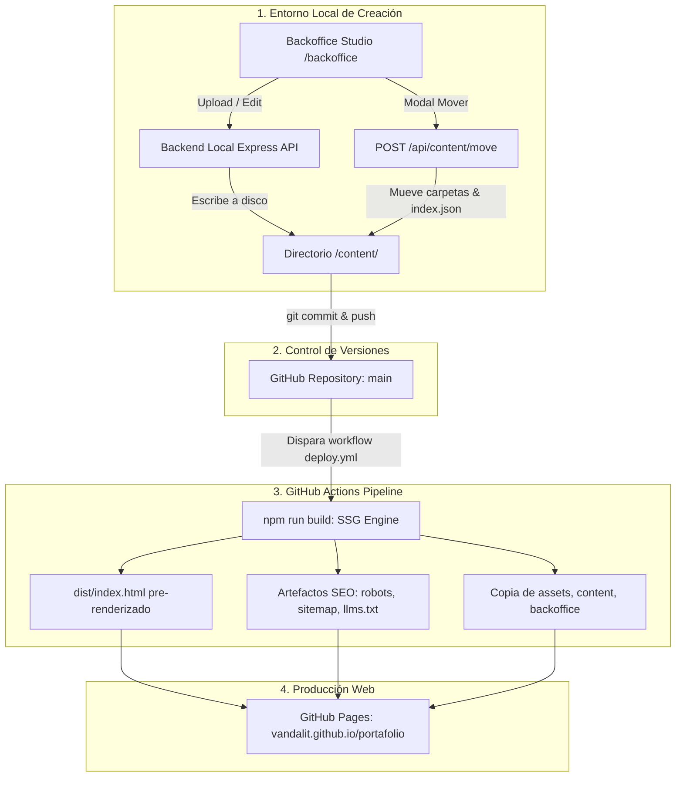

# vandalit · Portfolio & Content Studio

> Portafolio personal de diseño UX/UI, desarrollo front-end y experimentación visual.  
> Desplegado como sitio estático de alto rendimiento en **GitHub Pages** mediante **Static Site Generation (SSG)** con hidratación en cliente, pipeline CI/CD en **GitHub Actions** y panel de administración **Studio / Backoffice** integrado.

[](https://vandalit.github.io/portafolio)
[](http://localhost:3000/backoffice/)
[]()
[]()

---

## 🧭 Visión y Arquitectura

Portafolio one-page de **vandalit** — diseñador front-end UX/UI enfocado en interfaces limpias, motion design, microinteracciones y sistemas escalables.

El proyecto está diseñado bajo una filosofía **100% modular, desacoplada y estática**:
1. **Frontend en Vanilla JS / CSS3 puro**: Cero dependencias de frameworks pesados, velocidad de carga instantánea y animación acelerada por hardware.
2. **Arquitectura Sandwich Multi-Capa en el Hero**:
   - **Capa 0 (`z-index: 0`)**: Video de fondo ambiental YouTube de dos etapas con fundido suave (*crossfade*) por scroll.
   - **Capa 1 (`z-index: 11`)**: Escena Three.js posterior (geometrías 3D en cel-shading y rotación interactiva).
   - **Capa 2 (`z-index: 12`)**: 12 interfaces Bento flotantes con físicas 2D de barrido por scroll.
   - **Capa 3 (`z-index: 14`)**: Escena Three.js frontal que ocluye selectivamente las tarjetas.
   - **Capa 4 (`z-index: 20`)**: Tipografía y branding del Hero.
   - **Capa 5 (`z-index: 30-32`)**: HUD interactivo frontal con animación *pop stroke* en yellow-green (`#ccf020`), flechas de callout informativas, metadata técnica y enlaces de ancla.
3. **Contenido Desacoplado (`/content/`)**: Los proyectos y textos no están *hardcodeados*. Cada trabajo vive en su propio subdirectorio con su manifiesto `project.json`, y la landing entera se hidrata dinámicamente desde `site.json` y `hero.json`.
4. **Studio & Backoffice Híbrido (`/backoffice/`)**: Interfaz visual de gestión conectada en local a un **Backend Node.js API** con subida real de imágenes por drag & drop, reorganización con migración física de proyectos entre secciones (`/api/content/move`) y persistencia directa a disco.
5. **Generador Estático y Pipeline CI/CD (`build/build.js` + GitHub Actions)**:
   - **Zero-latency First Paint (SSG):** Al compilar con `npm run build`, se inyectan las tarjetas de casos, habilidades, trabajos y lab directamente en el HTML. Los crawlers y visitantes reciben el DOM completo de inmediato sin pantallas en blanco ni peticiones bloqueantes en el cliente.
   - **Optimización para Asistentes y Motores Generativos (GEO):** Generación automática de `llms.txt`, `sitemap.xml` y `robots.txt` con la metadata de proyectos y perfil técnico calibrado.
   - **Despliegue Continuo a GitHub Pages:** El workflow `.github/workflows/deploy.yml` compila y publica automáticamente la carpeta `./dist/` en cada push a `main`.

---

## 📁 Estructura del Repositorio

```text
portafolio/
├── index.html                     # One-page principal (GitHub Pages entry point)
├── server.js                      # Backend local Express (API REST y upload de medios)
├── package.json                   # Dependencias y scripts de ejecución
├── README.md                      # Documentación del proyecto
├── docs/                          # Especificaciones y estrategias
│   ├── ARCHITECTURE.md            # Decisiones técnicas de capas y z-index
│   ├── BACKEND_HYBRID_PLAN.md     # Arquitectura híbrida y plan de backend
│   ├── DESIGN_SYSTEM.md           # Tokens, tipografía y paleta
│   ├── MODULAR_CONTENT_STRATEGY.md # Arquitectura del motor de contenidos
│   └── PERFORMANCE_AUDIT.md       # Auditoría de rendimiento a 60/120fps y eliminación de jank
│
├── content/                       # ── DIRECTORIO UNIFICADO DE CONTENIDO ──
│   ├── settings/
│   │   ├── site.json              # Configuración global (Hero, textos de secciones, footer)
│   │   └── hero.json              # Configuración de 12 bentos y videos de fondo
│   ├── case-studies/              # Sección: Casos de Estudio Seleccionados
│   │   ├── index.json             # Lista y orden de slugs en carrusel
│   │   ├── project.template.json  # Plantilla base en blanco
│   │   ├── syzygy/                # Subcarpeta por proyecto autónomo
│   │   │   ├── project.json       # Metadata, reto, solución y galería
│   │   │   └── [assets locales]
│   │   └── [afk, kaktus, twitch-redesign, multipip, card-tools...]
│   ├── clients/                   # Sección: Trabajo de Clientes
│   │   ├── index.json             # Lista y orden de slugs en grid
│   │   ├── project.template.json  # Plantilla base en blanco
│   │   ├── lickancoy/
│   │   │   └── project.json
│   │   └── infinito/
│   │       └── project.json
│   ├── lab/                       # Sección: Experimentos & AI Workflows
│   │   ├── index.json             # Lista y orden de slugs de laboratorio
│   │   └── [cssdriven-v1, cssdriven-v2, paprika...]
│   └── skills/                    # Sección: Perfil Técnico
│       └── skills.json            # 6 Habilidades con doodles SVG y pills
│
├── backoffice/                    # ── PANEL DE ADMINISTRACIÓN / STUDIO ──
│   ├── index.html                 # UI del estudio (CRUD, media, site copy, hero)
│   ├── backoffice.css             # Estética de consola oscura y glassmorphism
│   └── backoffice.js              # Motor reactivo, conexión a API local y export/import
│
├── src/                           # ── CÓDIGO FUENTE DE LA APLICACIÓN ──
│   ├── components/
│   │   └── bentos/                # Módulo de 12 tarjetas Bento + HUD
│   │       ├── bento-base.js      # Factory de físicas y capas Bento + HUD
│   │       ├── bento-manager.js   # Orquestador dinámico (consume hero.json)
│   │       ├── bentos.css         # Tokens, pop stroke (#ccf020) y animaciones
│   │       └── bento-card-*.js    # Definiciones geométricas de tarjetas 1 a 12
│   ├── css/
│   │   ├── base.css               # Reset, tokens de color (#d4205a, #ccf020) y fuentes
│   │   ├── layout.css             # Grid elástico, sandwich 3D y contenedores
│   │   └── components.css         # Cards, modal split-canvas, pills y tabs
│   └── js/
│       ├── main.js                # Bootstrap del portafolio e hidratación de site.json
│       ├── content-loader.js      # Fetcher universal con resolución CONTENT_BASE_URL
│       ├── three-scene.js         # Escena Three.js dual-canvas
│       ├── video-bg.js            # Video YouTube dual-stage crossfade
│       ├── carousel.js            # Motor elástico drag + snap + progress bar
│       ├── grid-filter.js         # Filtrado interactivo por categorías
│       └── project-modal.js       # Modal de detalle split-canvas con galería
│
└── assets/
    ├── icons/                     # Favicons y SVGs
    └── images/                    # Demos, capturas y mockups
```

---

## 🛠️ Panel de Administración: Studio & Backoffice (`/backoffice/`)

El portafolio incluye un panel visual integrado accesible en `/backoffice/` (o haciendo clic en **Studio** en el pie de página del portafolio).

```text
┌────────────────────────────────────────────────────────────────────────┐
│  VANDALIT STUDIO / BACKOFFICE                   [💾 Guardar en Disco]  │
├──────────────┬─────────────────────────────────────────────────────────┤
│  PROYECTOS   │  Selector: [ Syzygy (syzygy)              ▼ ] [+ Nuevo] │
│  • Casos (8) │  Acción:   [Mover a: Lab ▼] [Ejecutar Traslado]         │
│  • Clientes(2│─────────────────────────────────────────────────────────┤
│  • Lab (3)   │  ID / Slug:  [syzygy            ]  Categoría: [motion ] │
│  • Skills (6)│  Título:     [Syzygy Design Sys ]  Cliente:   [Personal]│
│  • Hero (12) │  Tags:       [design-system, motion, ui               ] │
├──────────────┤  Cover:      [cover.webp       ] [🟢 OK: Asset detectado]│
│  SISTEMA     │  Galería:    [01.webp, 02.webp                        ] │
│  • Exportar  │  Reto:       [Crear una identidad visual con motion...] │
│  • Importar  │  Solución:   [Desarrollo de un canvas cel-shading...]   │
└──────────────┴─────────────────────────────────────────────────────────┘
```

### Capacidades principales:

1. **Gestión de Secciones Autónomas:**
   - **Casos de Estudio**, **Trabajo de Clientes**, **Laboratorio IA** y **Skills**.
   - Cada sección lee directamente de su carpeta en `/content/` sin inyecciones artificiales ni duplicidad de elementos.
   - Reordenamiento visual mediante botones `▲ Subir` y `▼ Bajar` (sincroniza en tiempo real el array en `index.json`).
   - Creación de nuevos proyectos mediante el botón **+ Nuevo**, autocompletando con la plantilla oficial `project.template.json`.
   - Eliminación segura con confirmación.

2. **Reubicación de Proyectos ("Mover a..."):**
   - Permite trasladar proyectos enteros mal clasificados entre secciones (por ejemplo, mover un caso de estudio hacia laboratorio).
   - En entorno local con acceso a disco, traslada físicamente la carpeta del proyecto a la nueva sección y actualiza de inmediato los `index.json` de origen y destino.

3. **Editor de Skills & Capacidades Técnicas:**
   - Gestión integral de las 6 tarjetas de habilidades del carrusel de perfil.
   - Configuración de títulos, categoría, etiquetas de filtro y descripción.
   - Selector visual de íconos Doodle SVG concéntricos (**Círculo**, **Cuadrado**, **Triángulo**).
   - Selector de color de acento temático (**Magenta** `#d4205a` o **Lime** `#b6e030`).
   - Editor de capacidades / *pills* con previsualización en vivo 1:1 idéntica a la tarjeta del portafolio.

4. **Hero & Bentos Studio:**
   - **Videos Ambientales de Fondo:** Configuración de los IDs de video de YouTube para la etapa 1 (Hero) y etapa 2 (Secciones), junto al umbral de scroll en píxeles para el fundido cruzado (*crossfade*).
   - **12 Bentos Flotantes:** Editor individual para cada tarjeta Bento (1 a 12), permitiendo definir:
     - Tipo de medio (`image` o `video`).
     - Ruta de medio local (`./content/...`) o URL remota (mock).
     - Poster de previsualización.
     - Título HUD, etiqueta técnica/meta, dirección de flecha de callout y ancla de destino (`#work`, `#cases`, `#lab`, `#skills`).

5. **Verificador de Rutas de Imágenes (Asset Checker):**
   - Detecta al escribir si el archivo de imagen especificado en `cover` existe físicamente en el servidor local devolviendo un badge visual:
     - `🟢 OK` (HTTP 200: archivo detectado y listo).
     - `🔴 404` (HTTP 404: archivo aún no colocado en la carpeta correspondiente).

6. **Persistencia Híbrida Inteligente (Local vs Web):**
   - **En Servidor Local (File System Access API):** El navegador solicita acceso a la carpeta del repositorio con `window.showDirectoryPicker()`. Al presionar **"💾 Guardar en Disco"**, el Backoffice escribe de forma nativa los archivos `project.json`, `index.json`, `hero.json` y `skills.json` directamente al almacenamiento físico, sin requerir scripts auxiliares ni servidores Node.js.
   - **En Despliegue Web (GitHub Pages):** Opera en modo seguro guardando borradores en `localStorage`. Almacena únicamente texto y referencias de ruta (menos de 25 KB), protegiendo la cuota del navegador y evitando el guardado destructivo de binarios en base64.
   - **Exportación e Importación JSON:** Genera y lee archivos descargables `vandalit-portfolio-config.json` para transferir configuraciones entre navegadores o respaldar cambios.

---

## 🏷️ Sistema Dinámico de Contenido, Tags y Layout

### 1. ¿Cómo se descubren los Tags y Categorías?
- Los tags no están pre-definidos de forma rígida en un archivo global.
- Cada proyecto define su propio array `"tags": ["ux", "wordpress", "design-system"]` en su `project.json`.
- En el arranque, el componente `grid-filter.js` analiza todos los proyectos cargados en la sección de Clientes, extrae los tags únicos de forma dinámica y genera automáticamente los botones de filtrado en la cabecera del grid.

### 2. Estabilidad de los Layouts al Añadir Nuevos Elementos
- **Casos de Estudio (`#cases`):** Motor de carrusel elástico horizontal con soporte touch/mouse drag, snapping por inercia y barra de progreso proporcional dinámica. Soporta cualquier cantidad de casos sin romper el flujo vertical.
- **Clientes (`#work`):** CSS Grid elástico con auto-fill (`minmax(320px, 1fr)`) que se adapta fluidamente a 2, 4, 10 o más clientes en pantallas de escritorio, tablets y móviles.
- **Laboratorio (`#lab`):** Grid de experimentación con estética visual de fichas técnicas y links a demos interactivas.
- **Skills (`#skills`):** Carrusel apaisado de cards interactivas con layout flexible de *pills* que envuelven su contenido (*flex-wrap*) sin desbordar.

---

## 🧩 Esquemas de Manifiestos de Datos

### A. Proyectos (`content/[sección]/[slug]/project.json`)

```json
{
  "id": "lickancoy",
  "category": "wordpress",
  "title": "Turismo Lickancoy",
  "client": "Turismo Lickancoy",
  "subtitle": "Sitio web de turismo para la comunidad atacameña",
  "description": "Diseño que honra el territorio: tonalidades del desierto y fotografía protagonista.",
  "year": 2023,
  "role": "UX/UI Design + WordPress Dev",
  "tags": ["wordpress", "ux", "web"],
  "stack": ["WordPress", "Custom CSS", "Photography Direction"],
  "accentColor": "#ccf020",
  "featured": true,
  "cover": "cover.webp",
  "gallery": [
    "gallery/01-hero.webp",
    "gallery/02-mobile.webp"
  ],
  "challenge": "Transmitir la magnitud del desierto sin perder la calidez humana local.",
  "solution": "Sistema visual basado en ocres y terracotas con fotografía protagonista.",
  "result": "Sitio funcional con experiencia móvil optimizada e identidad coherente.",
  "links": {
    "live": "https://turismolickancoy.cl",
    "github": null
  }
}
```

> **Resolución de Assets:**
> - Rutas relativas (`cover.webp` o `gallery/01.webp`) son resueltas automáticamente por el loader anteponiendo la ruta del proyecto (`./content/clients/lickancoy/cover.webp`).
> - URLs remotas absolutas (`https://images.unsplash.com/...`) son respetadas directamente, permitiendo maquetar con imágenes externas de prueba (*mock mode*).

### B. Configuración del Hero (`content/settings/hero.json`)

```json
{
  "ambientVideos": {
    "stage1VideoId": "Hse_HTX6KGs",
    "stage2VideoId": "GKq9nKZpmu0",
    "transitionScrollPx": 450
  },
  "bentos": [
    {
      "id": 1,
      "type": "image",
      "src": "./content/case-studies/syzygy/cover.webp",
      "poster": "",
      "alt": "Syzygy Design System",
      "hud": {
        "title": "SYZYGY DESIGN SYSTEM",
        "meta": "FIGMA · DESIGN TOKENS",
        "arrowDirection": "top-right",
        "anchor": "#cases"
      }
    }
  ]
}
```

### C. Habilidades y Perfil (`content/skills/skills.json`)

Estructura calibrada por 3 ejes transversales (**Autoral/Multimedia**, **Desarrollo** y **Comercial**), con niveles técnicos y revelado porcentual en modal:

```json
{
  "legend": {
    "autoral":    { "label": "Multimedia y diseño", "color": "magenta" },
    "desarrollo": { "label": "Desarrollo",           "color": "lime"    },
    "comercial":  { "label": "Comercial",            "color": "mango"   }
  },
  "categories": [
    {
      "id": "diseno-producto",
      "order": 1,
      "title": "Diseño de producto",
      "technicalName": "UX/UI y diseño de producto",
      "description": "Investigación de usuarios, arquitectura de información, interfaces y sistemas de diseño.",
      "icon": "circle",
      "dots": ["autoral"],
      "workTab": "ux",
      "items": [
        { "name": "UX research y síntesis",     "level": "intermedio", "state": "confirmado" },
        { "name": "Arquitectura de información", "level": "intermedio", "state": "confirmado" },
        { "name": "Figma, UI y design systems",  "level": "intermedio", "state": "confirmado" },
        { "name": "Docencia UX/UI",              "level": "avanzado",   "state": "confirmado" }
      ]
    }
  ]
}
```

> **Interactividad & Filtros:**
> - Clic en los puntos de la leyenda filtra las tarjetas colapsándolas sin dejar huecos en el carrusel.
> - Botón `×` brutalista para deseleccionar rápidamente cualquier filtro activo.
> - Botón de "ojo" en el modal de detalle para visualizar la barra de nivel porcentual (`LEVEL_PCT`) por tecnología.

---

## 🔄 Flujo de Trabajo y Pipeline de Despliegue (CI/CD)



### Pasos habituales de publicación:

1. **Gestión de Contenido en Vivo:** Iniciar el servidor local (`npm run dev`) y acceder a `http://localhost:3000/backoffice/`.
2. **Edición Completa & Transferencia:** Modifica proyectos, traslada elementos entre secciones con el botón **"Mover a..."**, o edita textos globales en **🌐 Textos del Sitio**.
3. **Subida Real de Imágenes:** Arrastra archivos a las portadas o sube fotos a la galería; el backend las guarda directamente en sus subcarpetas de destino.
4. **Guardar a Disco:** Presiona **"💾 Guardar en Disco"**; el backend sincroniza en el acto los manifiestos `site.json`, `hero.json`, `skills.json`, `project.json` e `index.json`.
5. **Compilación y Verificación Local (Opcional):**
   ```bash
   npm run build
   ```
   *Genera y valida la integridad de `./dist` antes de subir.*
6. **Despliegue Automático:**
   ```bash
   git add .
   git commit -m "content: actualización de proyectos y nuevas habilidades"
   git push origin main
   ```
   *GitHub Actions detecta el commit, compila el sitio estático y actualiza GitHub Pages en segundos.*

---

## 🚀 Ejecución en Local

### Opción A (Recomendada): Con Backend Local API (Edición viva + Uploads)

```bash
# 1. Instalar dependencias del entorno de estudio
npm install

# 2. Iniciar servidor local
npm run dev

# 3. Acceder en el navegador:
# Portafolio:  http://localhost:3000/
# Studio:      http://localhost:3000/backoffice/
# Status API:  http://localhost:3000/api/status
```

### Opción B: Modo Estático Puro (Fallback sin NodeJS)

Puedes continuar usando cualquier servidor estático si solo deseas previsualizar:
```bash
python3 -m http.server 8000
# o: npx serve .
```
*(En este modo, el Studio operará guardando borradores en `localStorage` o mediante File System Access API).*

---

## 📬 Contacto

- **Autor:** vandalit
- **Email:** [vandalit@metamedia.cl](mailto:vandalit@metamedia.cl)
- **GitHub:** [@vandalit](https://github.com/vandalit)
- **Twitter / X:** [@vandalittt](https://twitter.com/vandalittt)

---

*Diseño que comunica. Código que respira.*

