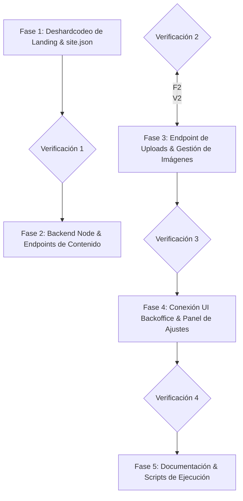

# Plan de Sesión: Backend Híbrido & Deshardcodeo de Contenido

> **Proyecto:** vandalit · Portfolio & Content Studio  
> **Objetivo:** Implementar un backend local liviano para edición viva y gestión real de imágenes y textos desde `/backoffice`, manteniendo compatibilidad nativa 100% estática para el despliegue en **GitHub Pages**.  
> **Estrategia ante cortes de contexto:** Fases atómicas, modulares e independientes, verificables por artefactos concretos.

---

## 1. Análisis y Recomendación de Conciliación (Local Vivo vs. GitHub Pages)

### El dilema técnico
1. En **local**, necesitas poder cambiar textos, reordenar proyectos y arrastrar imágenes sin lidiar con los diálogos de permisos de la File System API del navegador ni tipear rutas a mano.
2. En **GitHub Pages**, no existe servidor Node.js ni base de datos accesible en la nube: todo debe servirse como archivos estáticos (`.html`, `.json`, imágenes) de alto rendimiento.

### Recomendación: Arquitectura "Git-Backed CMS" (JSON-First + Backend Node Engine)

En lugar de crear una base de datos relacional aislada (como un archivo SQLite cerrado que obligue a exportar o compilar manualmente antes de cada push con riesgo de desincronización), la recomendación técnica óptima es un **Backend Node.js API que trata a la estructura de archivos (`/content/` y `/assets/`) como la base de datos real**:

```text
               ┌────────────────────────────────────────────────────────┐
               │                    ENTORNO LOCAL                       │
               │                                                        │
               │   Browser (/backoffice)                                │
               │     │  ▲                                               │
               │     │  │ Edición en vivo + Uploads (Multer)            │
               │     ▼  │                                               │
               │   Backend Local (Node.js / Express en :3000)           │
               │     │  │                                               │
               │     │  │ Escribe / Lee en tiempo real                  │
               │     ▼  │                                               │
               │   Archivos locales:                                    │
               │   ├── content/settings/site.json  <-- Nuevo            │
               │   ├── content/settings/hero.json                       │
               │   ├── content/{seccion}/{slug}/project.json            │
               │   └── assets/images/ & content/.../gallery/            │
               └──────────────────────────┬─────────────────────────────┘
                                          │
                        git commit & push (Checkpoint Natural)
                                          │
                                          ▼
               ┌────────────────────────────────────────────────────────┐
               │              PRODUCCIÓN: GITHUB PAGES                  │
               │                                                        │
               │   - Cero servidor, 0ms de arranque backend.            │
               │   - Lee directamente los JSONs y assets modificados.   │
               │   - 100% estático, ultra-rápido, costo $0.             │
               │   - Fallback de localStorage se mantiene activo.        │
               └────────────────────────────────────────────────────────┘
```

#### ¿Por qué esta es la mejor solución para conciliar ambos mundos?
1. **Checkpoint natural vía Git**: Cualquier cambio guardado desde el `/backoffice` actualiza directamente los archivos `.json` y carpetas de medios. `git status` y `git diff` son tu historial y tu checkpoint exacto. Para desplegar, solo haces `git push`.
2. **Cero discrepancias**: No hay una "base de datos oculta" que difiera de lo que ve el frontend. Lo que editas en local es idéntico a lo que consumirá GitHub Pages.
3. **Capa de abstracción conmutador (Hybrid Loader)**:
   - Si `window.location.hostname === 'localhost'`: el cliente consulta a `/api/...` para mutaciones en caliente.
   - Si está en producción: el cliente lee los archivos estáticos como siempre.

---

## 2. Mapa de Fases Atómicas (A prueba de cortes de contexto)

Cada fase produce un entregable funcional y verificable. Si la sesión se interrumpe en cualquier punto, se retoma exactamente desde la fase no concluida sin romper el funcionamiento actual.



---

### 📦 FASE 1: Deshardcodeo de Landing (`site.json` + Hidratación Front)
*Objetivo:* Eliminar los textos quemados en `index.html` para que todo el sitio sea configurable.

- [ ] **1.1 Crear manifiesto de configuración general:**
  - Archivo: `portafolio/content/settings/site.json`
  - Contenido:
    - Hero: eyebrow, título (`van· dalit`), tagline, llamados a la acción, email, redes (GitHub, Behance, Twitter).
    - Secciones: títulos, eyebrows y descripciones de `#cases`, `#skills`, `#work` y `#lab`.
    - Nota de IA en Lab (`labNote`).
    - Footer: logo, tagline, links.
- [ ] **1.2 Extender `content-loader.js`:**
  - Función `loadSiteSettings()` que consulte `content/settings/site.json` (con fallback de valores por defecto si falla la red).
- [ ] **1.3 Modificar `main.js` e `index.html`:**
  - Asignar IDs o data-attributes en `index.html` a los textos estáticos.
  - Hidratar dinámicamente dichos textos en el inicio del ciclo de vida de la página.
- **Criterio de éxito de Fase 1:** El sitio se ve exactamente igual, pero al modificar un texto en `site.json` y recargar, el cambio se refleja en la landing sin tocar el HTML.

---

### 📦 FASE 2: Servidor Backend Local & Endpoints de Datos
*Objetivo:* Montar un servidor Node.js ligero dentro de `portafolio/` que opere en local y sirva como API y servidor de desarrollo.

- [ ] **2.1 Crear `package.json` para portafolio:**
  - Dependencias mínimas y confiables: `express`, `cors`, `multer`.
  - Scripts: `npm run dev` (o `npm start`).
- [ ] **2.2 Crear `server/app.js` (o `server.js`):**
  - Servir estáticos de la carpeta `portafolio` (reemplaza a `python -m http.server`).
  - Endpoints REST:
    - `GET /api/status`: health-check y confirmación de modo local.
    - `GET /api/site`: obtiene `site.json`.
    - `PUT /api/site`: guarda cambios en `site.json`.
    - `GET /api/projects/:section`: lista de proyectos de una sección.
    - `POST /api/projects/:section`: crea/actualiza un proyecto (`project.json` e `index.json`).
    - `DELETE /api/projects/:section/:slug`: elimina carpeta y actualiza `index.json`.
    - `POST /api/projects/move`: traslada carpetas entre secciones en disco.
    - `GET /api/hero` y `PUT /api/hero`: lectura/escritura de `hero.json`.
    - `GET /api/skills` y `PUT /api/skills`: lectura/escritura de `skills.json`.
- **Criterio de éxito de Fase 2:** El servidor corre con `node server.js`, responde a `GET /api/status` y permite leer/escribir archivos JSON mediante llamadas HTTP sin diálogos del navegador.

---

### 📦 FASE 3: Endpoint de Subida y Procesamiento de Imágenes
*Objetivo:* Resolver el problema de arrastrar imágenes reales (portadas, galerías, bentos) y que queden guardadas en el disco local en su carpeta correspondiente.

- [ ] **3.1 Configurar `multer` en el backend:**
  - Endpoint `POST /api/upload`:
    - Parámetros: `section`, `slug`, `type` (`cover` | `gallery` | `bento` | `lab`).
    - Destino automático:
      - Si es proyecto: `content/<section>/<slug>/` (para cover o gallery).
      - Si es bento/general: `assets/images/bentos/` o `assets/images/`.
- [ ] **3.2 Manejo de nombres y sanitización:**
  - Evitar sobreescrituras accidentales o caracteres inválidos.
  - Retornar la ruta relativa lista para ser consumida en el JSON (ej. `cover.webp` o `gallery/03.jpg`).
- **Criterio de éxito de Fase 3:** Enviar un archivo vía `curl` o formulario y comprobar que aparece físicamente en la carpeta indicada con HTTP 200 y ruta relativa retornada.

---

### 📦 FASE 4: Adaptación del `/backoffice`
*Objetivo:* Integrar la interfaz del Studio con la nueva API local.

- [ ] **4.1 Detección automática del backend:**
  - En `backoffice.js`, verificar `fetch('/api/status')`.
  - Si el backend responde: activar modo **"API Backend Conectado"** (desactivar botón de File System API porque ya no se necesita).
  - Si el backend no responde (ej. en GitHub Pages): mantener modo **"GitHub Pages / localStorage"**.
- [ ] **4.2 Integrar subida en dropzones:**
  - Portada: arrastrar imagen sube directo vía `fetch('/api/upload')` y actualiza el campo.
  - Galería: botón *"Añadir imagen a galería"* permite seleccionar archivo real, subirlo y añadirlo a la lista.
  - Bentos: permitir subir archivo local para tarjetas tipo `image` o `video`.
- [ ] **4.3 Nueva pestaña en `/backoffice`: "Ajustes Generales" (Site Settings):**
  - Formulario para editar:
    - Hero (Nombre, eyebrow, tagline, email, redes).
    - Textos de cabecera de las 4 secciones.
    - Nota de IA.
- [ ] **4.4 Botón "Guardar Cambios":**
  - Envía la mutación directamente al endpoint correspondiente del backend, actualizando el archivo físico en el acto.
- **Criterio de éxito de Fase 4:** Abrir `http://localhost:3000/backoffice/`, editar un texto y subir una foto de galería; verificar que ambos se escribieron en disco sin pedir permisos de carpeta y que la portada se actualizó.

---

### 📦 FASE 5: Protocolo de Checkpoint & Deploy a GitHub Pages
*Objetivo:* Garantizar un flujo transparente y seguro de publicación.

- [ ] **5.1 Definir comando de checkpoint / validación:**
  - Script `npm run validate` que compruebe que todos los JSONs sean válidos y que las imágenes referenciadas existan antes de hacer commit.
- [ ] **5.2 Documentación del flujo de trabajo:**
  - Actualizar `README.md` con las nuevas instrucciones:
    1. `npm install`
    2. `npm run dev` -> Edición en `localhost:3000/backoffice/`
    3. `git add . && git commit -m "update: contenido"` -> `git push`
    4. GitHub Pages se actualiza de inmediato.
- **Criterio de éxito de Fase 5:** Documentación completa y verificación de que el repositorio puede desplegarse en GitHub Pages sin ninguna dependencia de backend en producción.

---

## 3. Resumen de Archivos a Crear / Modificar

| Tipo | Archivo | Responsabilidad |
| :--- | :--- | :--- |
| **Nuevo** | `content/settings/site.json` | Contenido antes hardcodeado (Hero, secciones, footer). |
| **Nuevo** | `package.json` | Dependencias del entorno local (Express, Multer, etc.). |
| **Nuevo** | `server.js` | Backend local y servidor estático. |
| **Modificado** | `index.html` | Atributos/IDs para hidratación dinámica de textos. |
| **Modificado** | `src/js/main.js` | Inyección de textos desde `site.json`. |
| **Modificado** | `src/js/content-loader.js` | Lógica de carga de `site.json`. |
| **Modificado** | `backoffice/index.html` | Pestaña de Ajustes Generales y UI de upload de galería. |
| **Modificado** | `backoffice/backoffice.js` | Conexión con endpoints `/api/*` y subida de archivos multipart. |
| **Modificado** | `README.md` | Guía de ejecución local con backend. |

