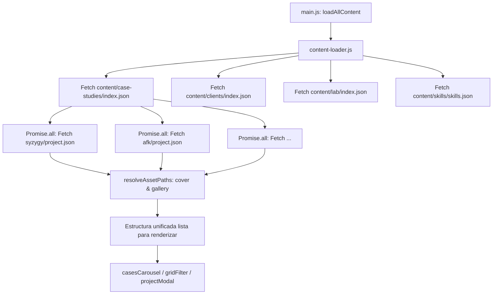

# Estrategia de Modularización y Arquitectura de Contenidos

**Proyecto:** vandalit Portfolio  
**Versión:** 1.0  
**Fecha:** Octubre 2026  
**Documento:** `docs/MODULAR_CONTENT_STRATEGY.md`

---

## 1. Visión y Objetivos

Actualmente, el portafolio consume un único archivo monolítico (`src/data/projects.json`) que agrupa todas las secciones del sitio (`cases`, `clients`, `lab`, `skills`). Aunque funcional en etapas tempranas, esta aproximación presenta limitaciones:
- **Acoplamiento**: Modificar un caso de estudio requiere editar un JSON de más de 280 líneas.
- **Riesgo de colisión**: No existe aislamiento entre secciones ni entre proyectos.
- **Gestión de assets desordenada**: Las imágenes residen en URLs remotas dispersas o en rutas globales difíciles de rastrear.

### Objetivos Clave
1. **Desacoplamiento total**: Cada una de las 3 secciones principales (`case-studies`, `clients`, `lab`) tendrá su propio directorio raíz.
2. **Aislamiento por proyecto**: Cada trabajo/proyecto vivirá en su propio subdirectorio autónomo con su manifiesto `project.json` y sus propios assets (portada, capturas, galería showcase).
3. **Compatibilidad Híbrida (Mock vs Local)**: El sistema admitirá URLs externas (`https://...`) durante la etapa mock y rutas locales relativas (`cover.webp`, `gallery/01.webp`) cuando se incorporen los archivos definitivos.
4. **Path Resolver inteligente**: El motor de carga normalizará automáticamente las rutas relativas respecto a la ubicación del proyecto, evitando tener que escribir rutas absolutas complejas en los JSON.
5. **Escalabilidad para la vista detalle (Showcase)**: Compatibilidad total con el modal de pantalla dividida (`ProjectModal`), permitiendo galerías dinámicas de 1 a N imágenes por proyecto.

---

## 2. Estructura de Directorios Propuesta

Se propone una carpeta de contenido unificada en la raíz del proyecto (`content/`):

```text
portafolio/
├── content/
│   ├── case-studies/                      # Sección: Casos de Estudio Seleccionados
│   │   ├── index.json                     # Manifiesto/orden de la sección
│   │   ├── syzygy/                        # Proyecto individual
│   │   │   ├── project.json               # Metadatos, descripción, stack y galería
│   │   │   ├── cover.webp                 # Portada local (o URL en project.json)
│   │   │   └── gallery/                   # Showcase para vista detalle
│   │   │       ├── 01-components.webp
│   │   │       ├── 02-tokens.webp
│   │   │       └── 03-motion.webp
│   │   ├── afk/
│   │   │   ├── project.json
│   │   │   └── ...
│   │   ├── kaktus/
│   │   ├── twitch-redesign/
│   │   ├── multipip/
│   │   └── card-tools/
│   │
│   ├── clients/                           # Sección: Trabajo de Clientes
│   │   ├── index.json                     # Manifiesto/orden de clientes
│   │   ├── lickancoy/
│   │   │   ├── project.json
│   │   │   ├── cover.webp
│   │   │   └── gallery/
│   │   │       ├── 01-hero.webp
│   │   │       └── 02-mobile.webp
│   │   └── infinito/
│   │       ├── project.json
│   │       └── ...
│   │
│   ├── lab/                               # Sección: Experimentos & AI Workflows
│   │   ├── index.json                     # Manifiesto/orden de experimentos
│   │   ├── cssdriven-v1/
│   │   │   ├── project.json
│   │   │   └── cover.webp
│   │   ├── cssdriven-v2/
│   │   └── paprika/
│   │
│   └── skills/                            # Sección: Perfil Técnico
│       └── skills.json                    # Habilidades y tokens de capacidades
│
├── docs/
│   └── MODULAR_CONTENT_STRATEGY.md        # Este documento
└── src/
    └── js/
        ├── content-loader.js              # Nuevo servicio de carga desacoplado
        ├── main.js
        └── project-modal.js
```

---

## 3. Esquema de Datos (`project.json`)

Cada subdirectorio de proyecto tendrá su propio archivo `project.json` estandarizado:

```json
{
  "id": "syzygy",
  "category": "coding",
  "title": "Syzygy",
  "subtitle": "Sistema de diseño astral",
  "description": "Un sistema de diseño construido desde el concepto astral...",
  "year": 2024,
  "role": "Design System Lead",
  "client": null,
  "tags": ["design-systems", "coding", "motion"],
  "accentColor": "#b6e030",
  "featured": true,
  "cover": "cover.webp",
  "gallery": [
    "gallery/01-components.webp",
    "gallery/02-tokens.webp",
    "gallery/03-motion.webp"
  ],
  "links": {
    "github": "https://github.com/vandalit/Syzygy",
    "live": null
  },
  "challenge": "Crear un sistema de diseño que pueda escalar...",
  "solution": "Tokens semánticos + motion principles...",
  "result": "Sistema funcional desplegado...",
  "stack": ["Design Systems", "Tokens", "CSS Motion", "Vanilla JS"]
}
```

### Flexibilidad de Rutas (Mock vs Local)
Si en etapa mock una imagen aún no existe físicamente en el subdirectorio, el campo en `project.json` simplemente conserva la URL remota:
```json
{
  "cover": "https://picsum.photos/seed/syzygy/1200/675",
  "gallery": [
    "https://picsum.photos/seed/syzygy-1/1200/800",
    "https://picsum.photos/seed/syzygy-2/800/1000"
  ]
}
```
Cuando se carguen los archivos reales en `content/case-studies/syzygy/`, solo se cambia en el JSON a `"cover": "cover.webp"`.

---

## 4. Path Resolver Inteligente

Para que el desarrollador o editor no tenga que escribir rutas absolutas largas como `./content/case-studies/syzygy/gallery/01.webp`, el servicio `content-loader.js` integrará una función de normalización:

```javascript
/**
 * Normaliza una ruta de asset:
 * - Si es URL externa (http:// o https://): la deja idéntica.
 * - Si es relativa (ej: 'cover.webp' o 'gallery/01.webp'):
 *   le antepone la ruta base del proyecto (ej: './content/case-studies/syzygy/').
 */
function resolveAssetPath(basePath, assetPath) {
  if (!assetPath) return '';
  if (/^(https?:|\/\/|\/)/i.test(assetPath)) {
    return assetPath;
  }
  return `${basePath.replace(/\/+$/, '')}/${assetPath.replace(/^\/+/, '')}`;
}
```

### Ventajas:
1. Portabilidad: Si se renombra o mueve la carpeta general, las referencias internas de cada proyecto no se rompen.
2. Limpieza: `project.json` se mantiene minimalista y auto-contenido.
3. Transparencia: El resto de la UI (`main.js`, `ProjectModal`, `cases-carousel`, etc.) recibe rutas ya listas para usar en ``.

---

## 5. Arquitectura del Manifiesto de Sección (`index.json`)

Dado que un navegador estático no puede leer carpetas directamente con `fs.readdir()`, cada sección contará con un manifiesto ligero `index.json` que define el orden de presentación de los proyectos:

```json
// content/case-studies/index.json
[
  "syzygy",
  "afk",
  "kaktus",
  "twitch-redesign",
  "multipip",
  "card-tools"
]
```

### Flujo de Carga del `content-loader.js`:


---

## 6. Integración con la Vista Detalle (Modal Showcase)

En `src/js/project-modal.js`, la vista detalle ya cuenta con un área de galería Masonry (`.modal__masonry`) y paneles de metadatos (`.modal__meta-sections`).

Con la nueva arquitectura:
1. **Galería Múltiple Dinámica**: Si `project.json` tiene 1, 3 o 10 imágenes en `gallery`, el modal renderiza automáticamente todos los ítems con stagger animation.
2. **Fallback automático**: Si `gallery` está vacío o en desarrollo, se utiliza `cover` como showcase principal.
3. **Metadatos completos**: `client`, `year`, `role`, `challenge`, `solution`, `result` y `stack` se mapean directamente de forma limpia.

---

## 7. Plan de Implementación Paso a Paso

1. **Paso 1: Estructura de Carpetas**
   - Crear el directorio `content/` y sus subsecciones:
     - `content/case-studies/` (con carpetas para `syzygy`, `afk`, `kaktus`, `twitch-redesign`, `multipip`, `card-tools`).
     - `content/clients/` (con carpetas para `lickancoy`, `infinito`).
     - `content/lab/` (con carpetas para `cssdriven-v1`, `cssdriven-v2`, `paprika`).
     - `content/skills/`.

2. **Paso 2: Generación de Manifiestos y `project.json`**
   - Extraer la información existente en `src/data/projects.json` hacia sus respectivos archivos `project.json`.
   - Crear los archivos `index.json` en cada sección.
   - Crear `content/skills/skills.json`.

3. **Paso 3: Creación de `src/js/content-loader.js`**
   - Implementar las funciones:
     - `loadSection(sectionName)`: Lee el `index.json` y hace fetch paralelo de cada `project.json`.
     - `resolveAssetPath(projectDir, path)`: Normaliza rutas relativas y remotas.
     - `loadAllContent()`: Carga `case-studies`, `clients`, `lab` y `skills`.

4. **Paso 4: Actualización de `main.js`**
   - Reemplazar la lectura directa de `projects.json` por `loadAllContent()`.
   - Mantener retrocompatibilidad total con las funciones `renderFeatured`, `renderCaseCards`, `renderSkillCards`, `renderClientGrid`, `renderLabGrid`.

5. **Paso 5: Verificación en Navegadores y Consola**
   - Probar carga en el servidor local `http://localhost:8000`.
   - Comprobar apertura del modal en casos de estudio y clientes.
   - Verificar que no existan errores 404 ni parpadeos.
